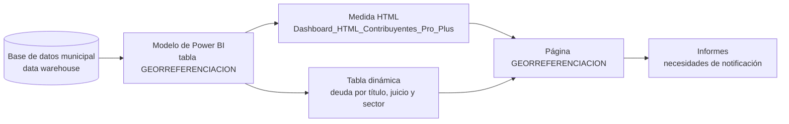
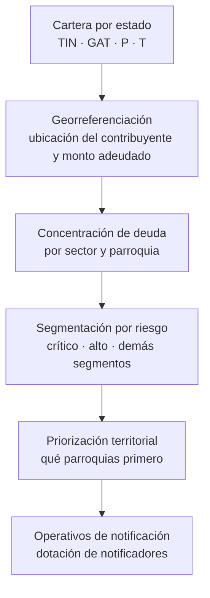
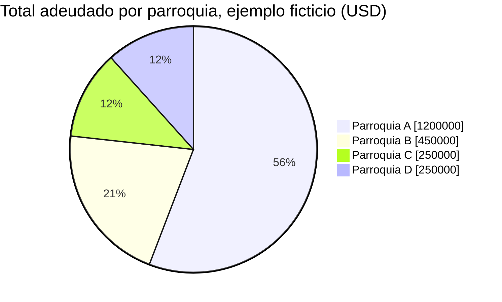

# SICOGE: Gestión de Cartera Basada en Análisis Geoespacial

Vista de análisis de la cartera de contribuyentes por tipo de deuda, título, juicio y sector, para la Dirección General Financiera de la M.I. Municipalidad de Guayaquil. Sirve para ubicar dónde se concentra la deuda y priorizar los operativos de notificación.

| | |
|---|---|
| **Idea y desarrollo de la georreferenciación** | Jorge Jamil Espinoza Villa, Analista Financiero |
| **Área** | Dirección General Financiera, M.I. Municipalidad de Guayaquil |
| **Estado** | En uso |
| **Plataforma** | Power BI (visual HTML Content) |
| **Fuente de datos** | Base de datos municipal en un data warehouse |
| **Uso** | Interno. Repositorio privado |

## Contenido

[Qué contiene](#qué-contiene) · [Flujo de datos](#flujo-de-datos) · [De la cartera al operativo](#de-la-cartera-al-operativo) · [Campos de la vista](#campos-de-la-vista) · [Ejemplo](#ejemplo-con-datos-ficticios) · [Estructura](#estructura-del-repositorio) · [Informes](#informes) · [Pendientes](#pendiente-por-documentar) · [Relacionados](#repositorios-relacionados)

## Qué contiene

SICOGE se documenta como la página `GEORREFERENCIACION` del dashboard de Power BI *Recaudación Municipal: Tablero Ejecutivo*. La georreferenciación se aplicó primero a los rubros de 1,5 por mil y Patente Municipal.

| Componente | Descripción |
|---|---|
| Panel de contribuyentes | Visual HTML Content alimentado por la medida `Dashboard_HTML_Contribuyentes_Pro_Plus` |
| Tabla de detalle | Tabla dinámica por tipo de deuda, título, juicio, sector de nomenclatura y contribuyente |

## Flujo de datos



## De la cartera al operativo



Los estados de cartera se explican en [`docs/estados-de-cartera.md`](docs/estados-de-cartera.md).

## Campos de la vista

Tabla del modelo: `GEORREFERENCIACION`.

| Tipo | Campos |
|---|---|
| Dimensiones | `TipoDeuda`, `AnioTitulo`, `NumeroTitulo`, `NumeroJuicio`, `AnioJuicio`, `SectorNomenclatura`, `NombreContribuyente` |
| Valor | suma de `ValorTotal` |
| Medidas | `Numero de contribuyentes`, `Promedio por Contribuyente` |
| Segmentación | `SO_Cartera_Base_Segmentacion`, `SO_Obligaciones_Base_Segmentacion`, `SO_Segmento_Contribuyente` |

Detalle en [`docs/vista-georreferenciacion.md`](docs/vista-georreferenciacion.md).

## Ejemplo con datos ficticios

Así se lee la concentración de deuda por parroquia. Las parroquias y las cifras son inventadas.

| Parroquia | Contribuyentes | Coactiva (USD) | Título (USD) | Total (USD) | Promedio por contribuyente (USD) |
|---|---:|---:|---:|---:|---:|
| Parroquia A | 3.000 | 800.000 | 400.000 | 1.200.000 | 400 |
| Parroquia B | 1.500 | 200.000 | 250.000 | 450.000 | 300 |
| Parroquia C | 1.000 | 150.000 | 100.000 | 250.000 | 250 |
| Parroquia D | 200 | 180.000 | 70.000 | 250.000 | 1.250 |



Una parroquia con pocos contribuyentes y alto promedio (como la D) pide gestión individualizada; una con muchos contribuyentes y promedio bajo (como la A) pide operativos de cobertura amplia.

## Estructura del repositorio

```
.
├── README.md
├── CHANGELOG.md                      historial de cambios
├── .github/                          verificación automática y plantilla de cambios
├── docs/
│   ├── vista-georreferenciacion.md   campos y medidas de la página de Power BI
│   └── estados-de-cartera.md         TIN, GAT, P y T
└── informes/
    ├── README.md
    ├── informe-necesidades-de-notificacion_v202609.pdf
    └── presentacion-necesidades-de-notificacion_v202609.pdf
```

## Informes

Los informes que usan esta información están en [`informes/`](informes/): el informe de necesidades de notificación y su presentación.

## Pendiente por documentar

- [ ] Si el visual HTML dibuja un mapa o solo paneles y tablas.
- [ ] Método de geocodificación y fecha de la última actualización de coordenadas.
- [ ] Vista o tabla de origen de `GEORREFERENCIACION` en el data warehouse y frecuencia de actualización.
- [ ] Usuarios con acceso.

## Repositorios relacionados

- [Dashboards-de-Power-BI](https://github.com/jamil73jev/Dashboards-de-Power-BI): dashboard *Recaudación Municipal*, que contiene la página GEORREFERENCIACIÓN, y consultas de cartera.
- [SIGECO](https://github.com/jamil73jev/SIGECO): sistema de gestión de cobranza que opera sobre la misma cartera.

## Historial de cambios

Ver [`CHANGELOG.md`](CHANGELOG.md). Los cambios se revisan con la lista de la plantilla de pull request y con la verificación automática de `.github/`.

## Datos y seguridad

Este repositorio **no contiene datos de contribuyentes ni coordenadas**, ni el archivo `.pbix`. Los ejemplos con datos ficticios están marcados como tales. Los PDF de `informes/` traen cifras agregadas institucionales: ver `informes/README.md`.
