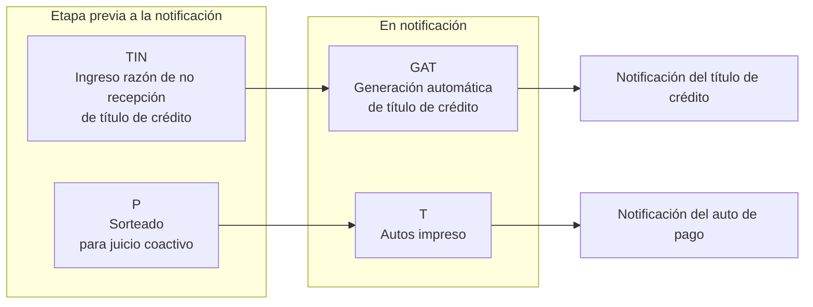

# Estados de cartera

Estados que usa el informe de necesidades de notificación para clasificar la cartera según su etapa. Fuente: el informe y su presentación (corte del 16 de septiembre de 2026), en [`informes/`](../informes/).

| Estado | Significado | Tipo de cartera | Etapa |
|---|---|---|---|
| `TIN` | Ingreso razón de no recepción de título de crédito | Títulos de crédito | Previa |
| `GAT` | Generación automática de título de crédito | Títulos de crédito | En notificación |
| `P` | Sorteado | Coactiva | Previa |
| `T` | Autos impreso | Coactiva | En notificación |

La cartera es un flujo: lo que hoy está en una etapa previa pasa después a notificación, por eso el informe dimensiona la capacidad de notificación sobre ambas etapas.
