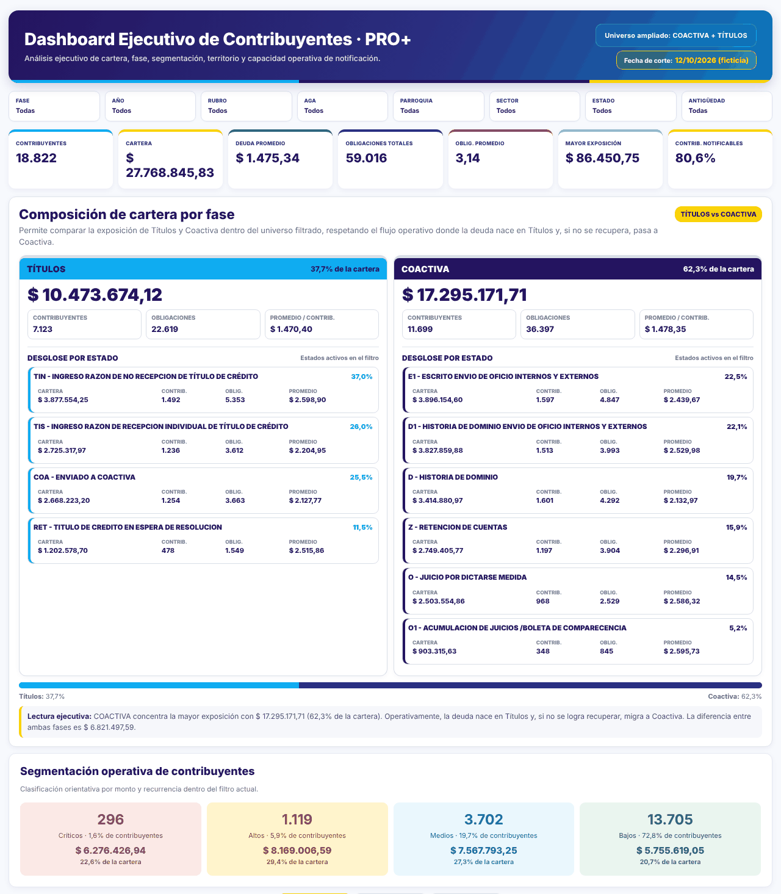
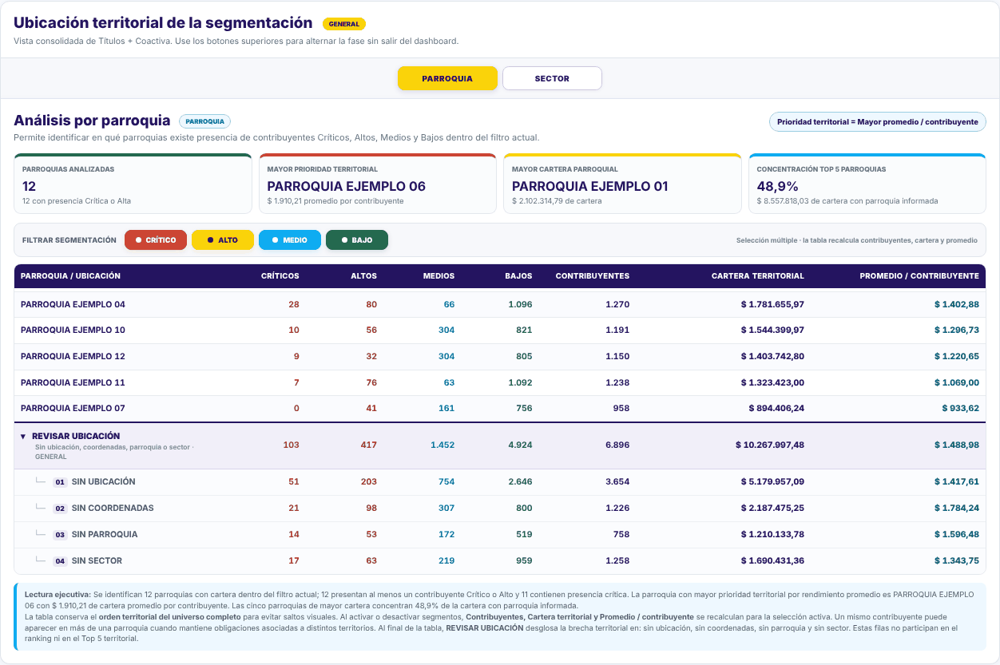
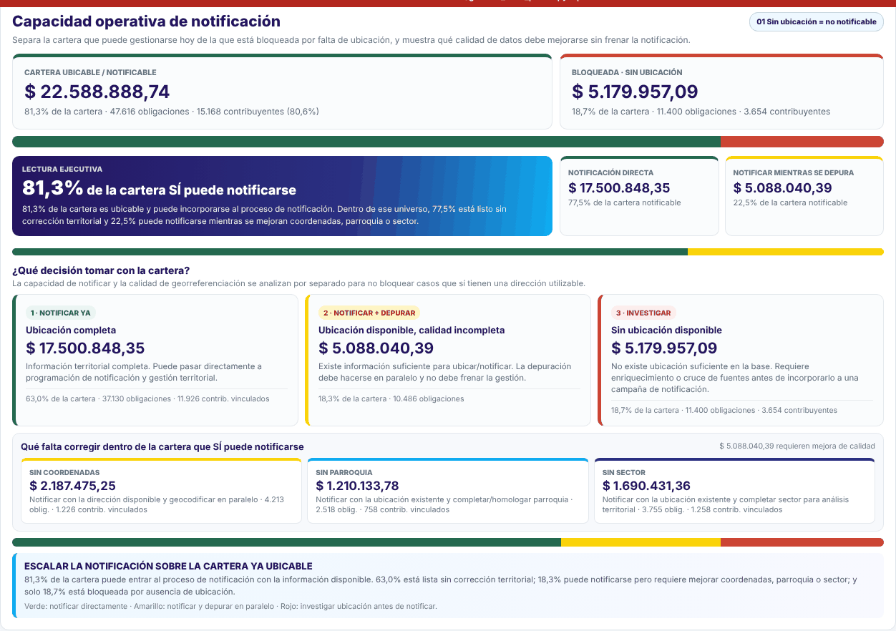
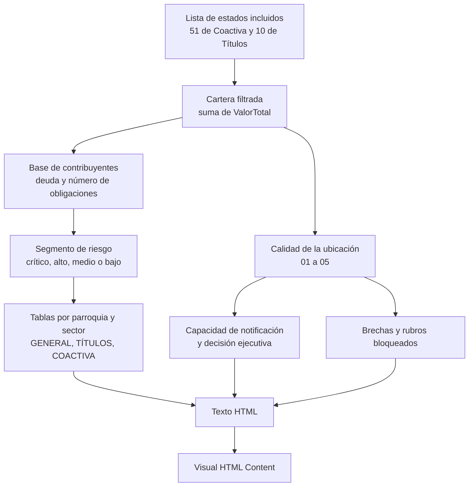

# Medida HTML del dashboard de georreferenciación

La página `GEORREFERENCIACION` del dashboard *Recaudación Municipal* muestra un panel ejecutivo dibujado por una sola medida DAX, `Dashboard_HTML_Contribuyentes_Pro_Plus`. La medida devuelve un texto HTML con sus estilos y Power BI lo muestra con el visual **HTML Content**.

| | |
|---|---|
| **Código** | [`dax/dashboard-html-contribuyentes-pro-plus_v202610.dax`](../dax/dashboard-html-contribuyentes-pro-plus_v202610.dax) |
| **Tabla del modelo** | `GEORREFERENCIACION` |
| **Vista previa** | [`docs/vista-previa/georreferenciacion.html`](vista-previa/georreferenciacion.html) con datos ficticios |
| **Generador de la vista previa** | [`herramientas/generar_vista_previa.py`](../herramientas/generar_vista_previa.py) |

## Qué muestra

El panel **no dibuja un mapa**: son tarjetas, tablas y barras. No contiene JavaScript ni recursos externos (ni fuentes ni imágenes); los botones usan solo CSS.

| Bloque | Qué responde |
|---|---|
| Filtros activos y fecha de corte | Qué segmentaciones de Power BI están aplicadas y con qué corte de datos se calculó |
| Indicadores | Contribuyentes, cartera, deuda promedio, obligaciones, obligaciones promedio, mayor exposición y porcentaje de contribuyentes notificables |
| Composición por fase | Cuánto de la cartera está en Títulos y cuánto en Coactiva, con desglose por estado |
| Segmentación operativa | Contribuyentes críticos, altos, medios y bajos, con su monto y su peso en la cartera |
| Ubicación territorial | Por parroquia y por sector, en tres vistas (GENERAL, TÍTULOS, COACTIVA), con filtro por riesgo y la fila **REVISAR UBICACIÓN** |
| Capacidad de notificación | Qué parte de la cartera se puede notificar hoy y qué decisión tomar |
| Rubros bloqueados | Tipos de deuda sin ubicación, ordenados por monto |

## Pantallas (datos ficticios)

Fases y segmentación:



Ubicación territorial con la fila **REVISAR UBICACIÓN** desglosada en sus cuatro brechas:



Capacidad de notificación:



## Cómo calcula



### Cartera considerada

Entra a la cartera solo lo que esté en la lista de pares *fase y estado* que abre la medida: 51 estados de Coactiva (`COA`) y 10 de Títulos (`TIT`). Los códigos de los estados de ejemplo, como TIN, GAT, P y T, se explican en [`estados-de-cartera.md`](estados-de-cartera.md). Si se crea un estado nuevo en el sistema de origen, hay que agregarlo a esa lista.

### Segmento de riesgo del contribuyente

Se evalúa por contribuyente, con su deuda total y su número de obligaciones. Basta con cumplir uno de los dos criterios.

| Segmento | Deuda | o número de obligaciones |
|---|---:|---:|
| Crítico | ≥ 10.000 | ≥ 11 |
| Alto | ≥ 5.000 | ≥ 6 |
| Medio | ≥ 1.000 | ≥ 4 |
| Bajo | el resto | el resto |

### Calidad de la ubicación

La ubicación nace del catastro del predio (ver [De dónde nace la ubicación](segmentacion-y-calidad-de-ubicacion.md#de-dónde-nace-la-ubicación)). El campo `CalidadUbicacion` clasifica cada deuda en una sola categoría, así que los tres grupos de abajo no se superponen y suman el 100 % de la cartera.

| Código | Significado | Se puede notificar | Decisión |
|---|---|---|---|
| 01 | Sin ubicación | No | 3 · Investigar |
| 02 | Sin coordenadas | Sí | 2 · Notificar y depurar |
| 03 | Sin parroquia | Sí | 2 · Notificar y depurar |
| 04 | Sin sector | Sí | 2 · Notificar y depurar |
| 05 | Ubicación completa | Sí | 1 · Notificar ya |

La decisión ejecutiva que muestra el panel se elige así:

1. Si la cartera sin ubicación (01) es el 25 % o más: *reducir la cartera bloqueada por falta de ubicación*.
2. Si no, y la cartera por depurar (02 a 04) es igual o mayor que la lista para notificar: *notificar y depurar en paralelo*.
3. En los demás casos: *escalar la notificación sobre la cartera ya ubicable*.

### Vistas por fase

La vista GENERAL usa la segmentación consolidada. Las vistas TÍTULOS y COACTIVA reutilizan los mismos contribuyentes por segmento y solo recalculan la distribución territorial de la cartera de cada fase. Así se evita duplicar todo el cálculo por cada pestaña. Un mismo contribuyente puede aparecer en más de una parroquia o sector si tiene obligaciones en varios.

### Orden de las tablas territoriales

Mayor promedio por contribuyente, luego mayor cartera, menor número de presencias y mayor prioridad. La fila **REVISAR UBICACIÓN** va siempre al final y no entra en el ranking ni en el Top 5.

## Campos que usa

| Campo de `GEORREFERENCIACION` | Para qué |
|---|---|
| `IdContribuyente` | Contar contribuyentes distintos |
| `IdDeuda` | Contar obligaciones distintas |
| `ValorTotal` | Monto de la cartera |
| `CodFaseDeuda` | Fase: `COA` o `TIT` |
| `EstadoEspecifico` | Estado dentro de la fase |
| `TipoDeuda` | Rubros bloqueados por falta de ubicación |
| `Parroquia`, `SectorNomenclatura` | Análisis territorial |
| `CalidadUbicacion` | Códigos 01 a 05 |
| `RangoAntiguedad`, `AnioIdDeuda`, `AGA` | Filtros que se muestran en el encabezado. AGA significa áreas de gestión administrativa |
| `FechaCorte` | Fecha de corte del panel |

## Cómo usarlo en Power BI

1. En el modelo que contiene la tabla `GEORREFERENCIACION`, crear una medida nueva con el nombre `Dashboard_HTML_Contribuyentes_Pro_Plus` y pegar el contenido del archivo `.dax`.
2. En la página, agregar el visual **HTML Content** y arrastrar la medida al campo de valores.
3. Los filtros de la página (fase, año, rubro, AGA, parroquia, sector, estado y antigüedad) recalculan el panel.

El archivo `.dax` ya incluye el nombre de la medida en su primera línea. Se ajustan las tablas y campos solo si el modelo cambia de nombres.

## Cómo ver el panel sin Power BI

El archivo [`vista-previa/georreferenciacion.html`](vista-previa/georreferenciacion.html) es una página normal con datos **inventados**: cada cálculo DAX se reemplaza por un valor ficticio y se conservan los estilos y la estructura reales de la medida. Se abre con doble clic en cualquier navegador y los botones de GENERAL, TÍTULOS, COACTIVA, PARROQUIA, SECTOR y el filtro por riesgo funcionan igual que en Power BI.

Para regenerarla después de cambiar la medida:

```bash
python3 herramientas/generar_vista_previa.py
```

Detalles a tener en cuenta:

- Los números salen de una semilla fija, así que cada ejecución produce los mismos valores.
- El formato numérico usa punto para miles y coma para decimales, como el modelo original.
- Si el HTML de la medida cambia de estructura (variables nuevas), el script avisa con el nombre de la variable que falta y se agrega su valor ficticio en `construir_contexto`.
- Los nombres de parroquias, sectores y rubros son genéricos («PARROQUIA EJEMPLO 01»). Los nombres de los estados de la cartera sí son los del catálogo de la medida, que no contiene datos de contribuyentes.
- En GitHub el archivo `.html` se ve como código. Para verlo dibujado hay que descargarlo, o usar las capturas de arriba.

## Datos y seguridad

La medida y la vista previa **no contienen datos de contribuyentes**: la medida es solo código y la vista previa usa datos inventados. El panel real sí mostraría cifras de cartera cuando se abre en Power BI, por lo que se comparte solo con personas autorizadas.
