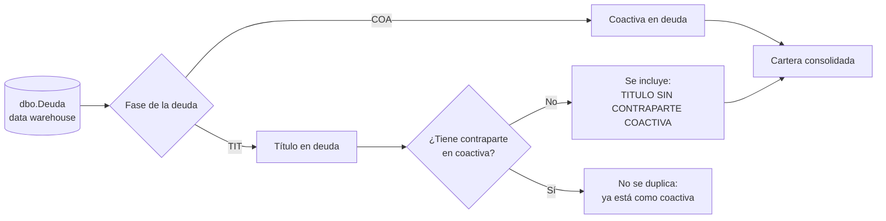
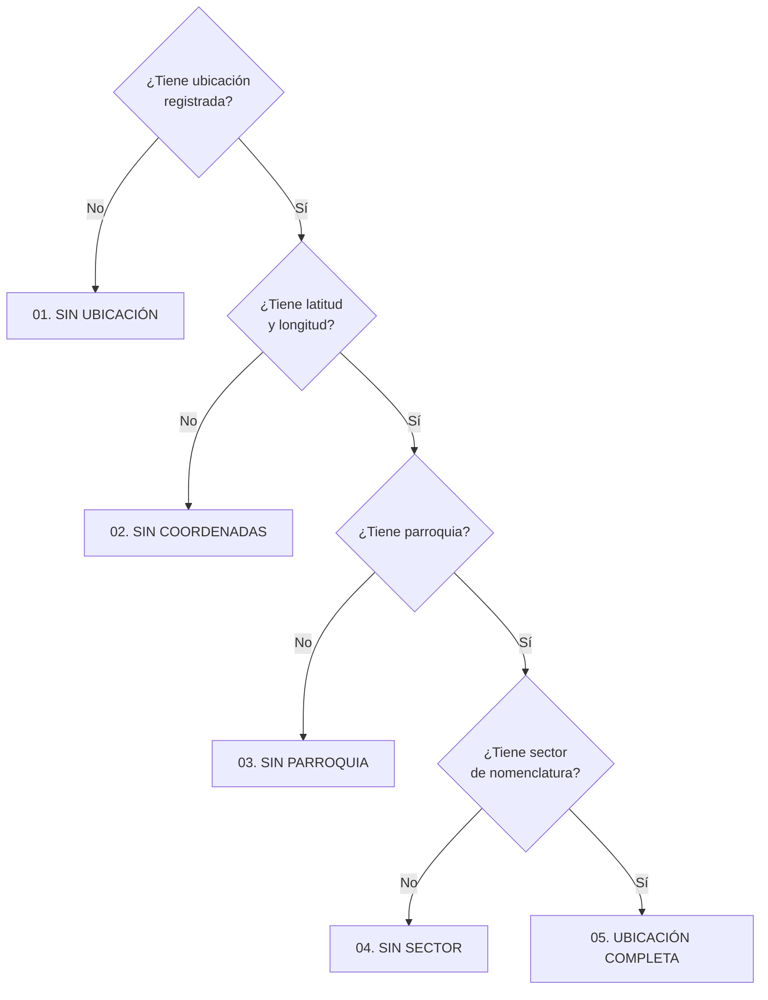

# Segmentación de cartera y calidad de la ubicación

Reglas con las que se prepara la cartera que se ve en la página GEORREFERENCIACIÓN. Están tomadas de la consulta [`cartera-consolidada_v202610.sql`](https://github.com/jamil73jev/Dashboards-de-Power-BI/blob/main/consultas/cartera-municipal/cartera-consolidada_v202610.sql) del repositorio de dashboards. Cada fila de esa consulta es una obligación de la cartera.

## Qué entra en la cartera

La cartera consolidada es la **coactiva en deuda más los títulos en deuda sin contraparte en coactiva**. Así un mismo valor no se cuenta dos veces. La consulta también trae tres juegos de valores para poder cuadrar: los principales de `dbo.Deuda`, los del corte temporal y los referenciales de las fuentes oficiales (`ValorTotal`, `ValorTotalTmp`, `ValorTotalReferencial`).

## Segmentos de gestión (Pareto)

Los contribuyentes se ordenan por deuda total, de mayor a menor, y se calcula la participación acumulada sobre la cartera. El segmento se asigna con la participación acumulada **anterior** al contribuyente, para que quien completa el 80 %, el 90 % u otro corte quede en su segmento.

| Segmento | Participación acumulada anterior | Lectura |
|---|---|---|
| A: Estratégico | menos de 80 % | Pocos contribuyentes con la mayor parte de la deuda |
| B: Alto valor | 80 % a menos de 90 % | |
| C: Medio | 90 % a menos de 95 % | |
| D: Masivo | 95 % a menos de 99 % | |
| E: Micro cartera | 99 % a 100 % | Muchos contribuyentes con montos pequeños |

## Calidad de la ubicación

Cada obligación recibe una calificación de qué tan utilizable es su ubicación, evaluada en este orden (se queda con la primera que se cumple):

Solo las obligaciones con **ubicación completa** sirven para trabajar por zona. El resto indica dónde hay que mejorar los datos. La consulta además conserva el origen de la ubicación (`OrigenUbicacion`) y su nivel de confianza (`NivelConfianzaUbicacion`), que son los campos donde se registra cómo se obtuvo cada coordenada.

## Antigüedad de la deuda

Se calcula como el año de corte menos el año de la deuda y se agrupa así:

| Rango | Años de antigüedad |
|---|---|
| 00. Año actual | 0 |
| 01. 1 año | 1 |
| 02. 2-3 años | 2 a 3 |
| 03. 4-5 años | 4 a 5 |
| 04. 6-10 años | 6 a 10 |
| 05. Más de 10 años | más de 10 |

> La consulta tiene el año de corte escrito como `2026`. Al cambiar de año hay que actualizarlo; de lo contrario la antigüedad sale mal.

## De dónde nace la ubicación

La geocodificación nace del **catastro del predio**. Cada predio se identifica con la clave catastral formada por seis campos: `Sector`, `Manzana`, `Lote`, `Division`, `Phv` y `Phh`. La ubicación de la deuda se obtiene al vincular la obligación con su predio en el catastro. Las consultas de títulos de predios usan esos mismos seis campos como llave única del catastro (por ejemplo [`titulos-de-predios-urbanos_v202610.sql`](https://github.com/jamil73jev/Dashboards-de-Power-BI/blob/main/consultas/cartera-municipal/titulos-de-predios-urbanos_v202610.sql)), y solo toman sus atributos cuando el vínculo catastral está validado.

Las coordenadas se actualizaron por última vez el **5 de octubre de 2026**.

Por eso la calidad de la ubicación (códigos 01 a 05) depende de que la obligación tenga un predio vinculado y de que ese predio tenga completos sus datos territoriales.

| Siglas de la clave | Significado |
|---|---|
| `Sector`, `Manzana`, `Lote`, `Division` | Los niveles de la clave catastral del predio |
| `Phv` | Propiedad horizontal vertical |
| `Phh` | Propiedad horizontal horizontal |

## Geografía y catastro disponibles

| Grupo | Campos |
|---|---|
| Geografía | `AGA` (áreas de gestión administrativa), `Parroquia`, `SectorNomenclatura`, `DireccionUbicacion`, `LatitudUbicacion`, `LongitudUbicacion` |
| Catastro | `Sector`, `Manzana`, `Lote`, `Division`, `Phv`, `Phh`, `Numero` |
| Contribuyente | `RankingDeudor`, `ObligacionesContribuyente`, `DeudaTotalContribuyente`, `ParticipacionAcumuladaPct`, `SegmentoGestion` |
